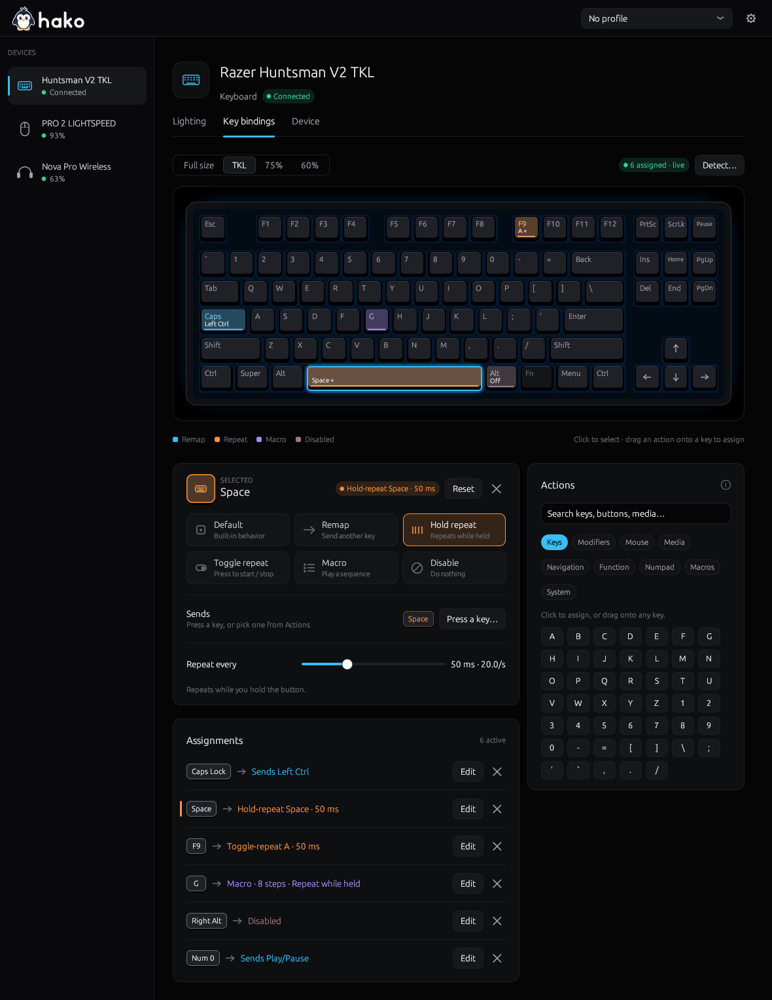
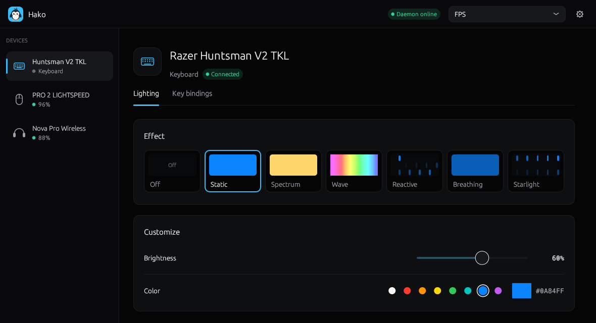
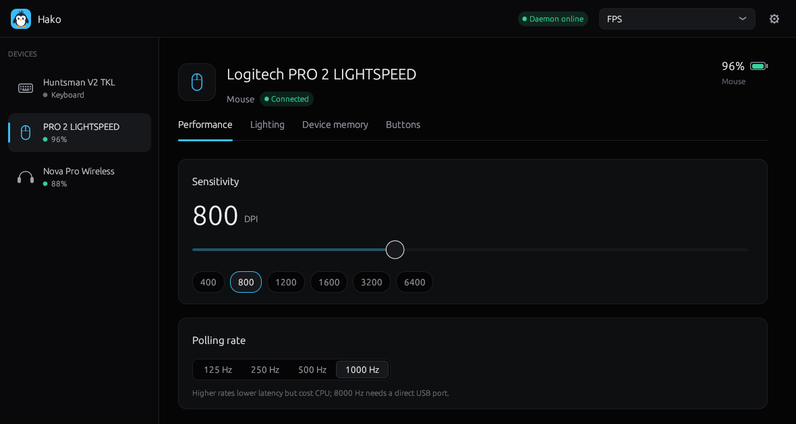
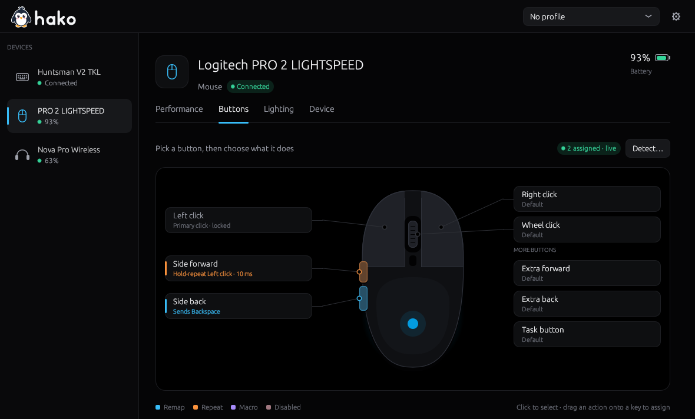
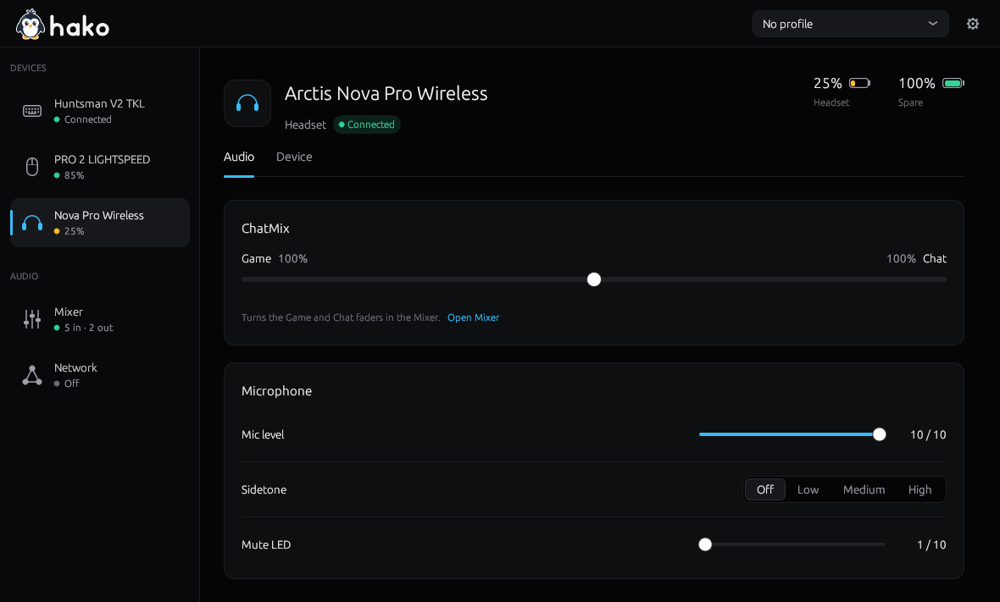
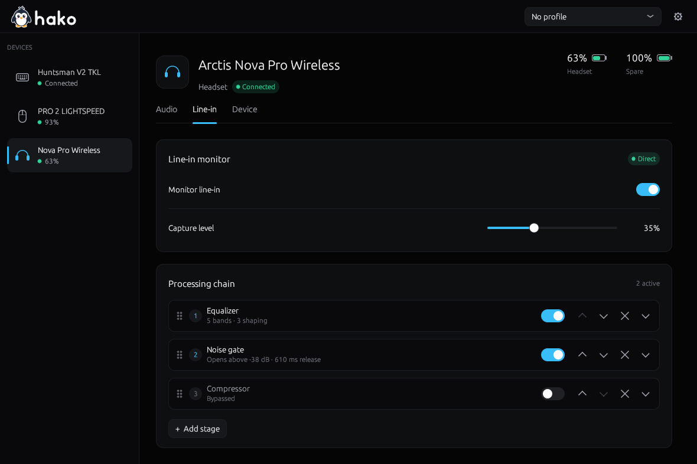
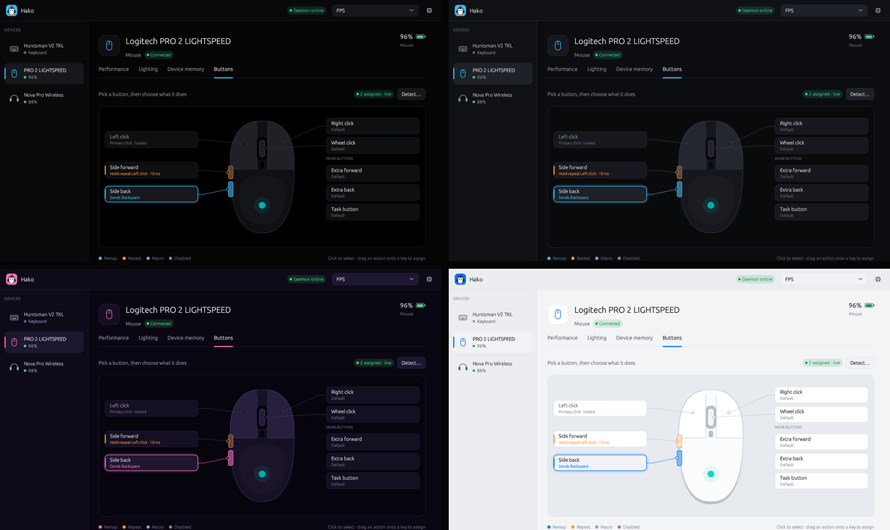
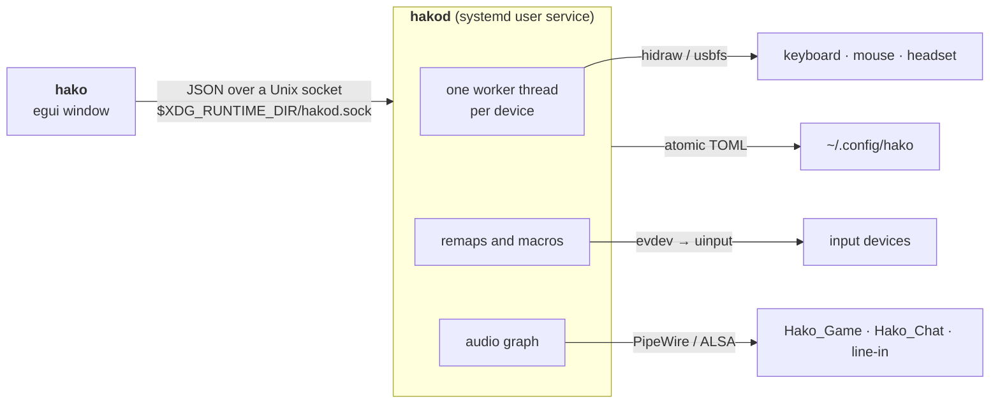

<div align="center">

<picture>
  <source media="(prefers-color-scheme: dark)" srcset="branding/logo/hako-logo-dark.svg">
  
</picture>

### All your gaming gear in one box.

One native control panel for your keyboard, mouse and headset on Linux.<br>
Lighting, DPI, key bindings, macros, ChatMix and line-in, without a single vendor app.

[](https://github.com/tifuck/Hako/actions/workflows/ci.yml)
[](https://github.com/tifuck/Hako/releases/latest)
[](LICENSE)


[**Download**](https://github.com/tifuck/Hako/releases/latest) ·
[Features](#features) ·
[Supported devices](#supported-devices) ·
[Install](#install) ·
[Build from source](#build-from-source)

<br>



</div>

<br>

**hako** (箱, *HAH-koh*, Japanese for *box*) replaces Razer Synapse, Logitech
G HUB, Corsair iCUE, SteelSeries GG, HyperX NGENUITY and Armoury Crate with one
small background service and one fast, native window. It is built for Linux
from the ground up: no Wine, no web view, no account, no telemetry.

Close the window and nothing stops. Your lighting, remaps, macros and audio
routing keep running in `hakod`, a systemd user service that starts with your
session.

<table>
<tr>
<td width="33%" valign="top">

**🎨 Lighting**<br>
Static, spectrum, wave, reactive, breathing, starlight and more, with speed,
direction, brightness and any colour.

</td>
<td width="33%" valign="top">

**🖱️ Mouse tuning**<br>
DPI with stages, polling rate up to 8000 Hz, angle snapping, lift-off
distance, debounce and live battery.

</td>
<td width="33%" valign="top">

**⌨️ Bindings and macros**<br>
Remap any key or button, turbo, toggle-repeat, record or hand-edit macros,
on any mouse or keyboard.

</td>
</tr>
<tr>
<td valign="top">

**🎧 Headsets**<br>
Battery (including hot-swap spares), sidetone, mic level, EQ, auto-off,
wireless range, voice prompts.

</td>
<td valign="top">

**🎚️ ChatMix and line-in**<br>
Real game and chat outputs driven by the headset's dial, plus line-in
monitoring through a gate, EQ and compressor.

</td>
<td valign="top">

**🗂️ Profiles**<br>
Save the state of every device under one name and switch from the top bar in
one click.

</td>
</tr>
<tr>
<td valign="top">

**🌗 Four themes**<br>
Onyx, Graphite, Synthwave and Daylight. Pip, the mascot, follows the accent
colour.

</td>
<td valign="top">

**🔄 Self-updating**<br>
Checks GitHub releases, verifies the download, then asks before it restarts
into the new version.

</td>
<td valign="top">

**🔒 Safe by default**<br>
Never touches firmware. Writes to a device's own memory stay off until you
allow them for that device.

</td>
</tr>
</table>

---

## Features

### Lighting that survives everything



- Pick an effect from live preview tiles: **off, static, spectrum, wave,
  reactive, breathing, starlight**, plus ripple, pulse, cycle and rainbow on
  devices that have them.
- Brightness, speed and direction where the effect supports them; colour from
  swatches or a full colour picker.
- Settings are **re-applied on every reconnect**: unplug, resume from suspend,
  switch the receiver, and the lighting comes back as you left it.
- Every control is declared by the device's driver, so you only ever see what
  your hardware can actually do.

### Mice, dialled in



- **DPI**: type an exact value, drag the number, or use the slider and its
  reference marks; up to five **DPI stages** on mice that cycle through them.
- **Polling rate** from 125 Hz up to 8000 Hz on mice that support it.
- **Angle snapping**, **lift-off distance** and **click debounce** where the
  firmware exposes them.
- Battery and charging state in the sidebar for every wireless device.
- Wireless receivers (Logitech Unifying, Lightspeed and Bolt, Razer HyperSpeed,
  Corsair Slipstream, ASUS Omni) are rescanned in the background, so a mouse
  you pair later just shows up.

### Every key and button, your way

<p>
  
</p>

- **Visual editors**: a drawn keyboard in full-size, TKL, 75% and 60% layouts,
  and a mouse diagram. Click a key, or press **Detect** and hit any key or
  button, including ones the drawing doesn't show.
- **Five actions** for any key or button:
  - **Remap**: send another key, mouse button or media key.
  - **Hold repeat** (turbo): repeats while held, every 10 ms to 10 s.
  - **Toggle repeat**: press once to start repeating, again to stop.
  - **Macro**: record live or build step by step (press, release, delay), up
    to 256 steps. Play once, repeat while held, or toggle a loop.
  - **Disable**: the key does nothing.
- Drag an action from the searchable library straight onto a key.
- Applied on your computer through the kernel's input layer, so it works with
  **any USB or Bluetooth mouse or keyboard**, even ones hako has no driver
  for, and nothing is written to the device.

### Headsets with the controls you were promised



- **Battery** for the headset, and for the hot-swap spare on the Arctis Nova
  Pro Wireless.
- **Microphone**: volume, sidetone, mute-LED brightness and noise filter,
  depending on the model.
- **Audio**: EQ presets and bands, volume limiter, voice prompts, Bluetooth
  call volume and power-on behaviour.
- **Power** (on the Device tab): auto-off timer and wireless range.
- **ChatMix** creates two real PipeWire outputs, `Hako_Game` and `Hako_Chat`.
  Route games to one and Discord to the other, and the dial on the headset
  balances them.

### Line-in monitoring with a real processing chain



Plug a console, a second PC or a mixer into your sound card's line-in and hear
it through your headset. The signal can run through a drag-to-reorder chain:

| Stage | Controls |
|---|---|
| **Noise gate** | threshold, reduction, attack, hold, release, and a detector high-pass so hum can't open the gate |
| **Compressor** | threshold, ratio, knee, attack, release, make-up gain |
| **Parametric EQ** | up to 8 bands: peaking, low and high shelf, low and high pass |

hako only manages its own nodes. It remembers your default output and puts it
back when it stops, and `hakod --reset-audio` is a one-command kill switch.

### Mixer (new)

A VoiceMeeter-style console under **Audio → Mixer**: merge several microphones
into one strip, send line-in or apps to several devices at once, and give
Discord or OBS their own virtual microphones. Every strip has a fader, meters,
mute, routing buttons and its own processing chain; save layouts as scenes.

### Make it yours



Four hand-tuned themes: **Onyx** (near-black), **Graphite**, **Synthwave** and
**Daylight**. Switch from Settings; the change is instant.

### Built to be trusted

- **Firmware is never written.** Ordinary settings are volatile and re-applied
  by the daemon.
- **Device memory is opt-in per device.** A setting that would be stored on
  the device itself (onboard DPI, saved lighting) stays locked until you
  confirm *Allow saving to device memory* for that device. Writes hako isn't
  confident about are shown, but blocked with the reason.
- **No root service.** The daemon runs as you. udev gives your login seat
  access to the supported devices only.
- **Private by design.** The only network request hako makes is the update
  check, and you can switch it off.

---

## Supported devices

**577 models from 13 brands**, plus any mouse or keyboard for remaps and
macros.

| Brand | Mice | Keyboards | Headsets | Receivers |
|---|:-:|:-:|:-:|:-:|
| Razer | 73 | 40 | 7 | |
| Corsair | 43 | 40 | 16 | |
| SteelSeries | 39 | 15 | 35 | |
| Logitech | 19 | 16 | 22 | 24 |
| ASUS ROG / TUF | 43 | 34 | 3 | |
| HyperX | 12 | 13 | 12 | |
| ROCCAT / Turtle Beach | 10 | 15 | 2 | |
| Cooler Master | 5 | 12 | | |
| Redragon | 12 | | | |
| Glorious | 7 | | | |
| Sony INZONE / PULSE | | | 4 | |
| Audeze | | | 2 | |
| MSI | 1 | 1 | | |

The full list with USB IDs and status is in
**[docs/DEVICES.md](docs/DEVICES.md)**.

hako also recognises devices that aren't in the list:

- **Logitech HID++** mice and keyboards are detected from their protocol.
- **QMK / VIA** keyboards get lighting control over raw HID.
- **Any other USB or Bluetooth mouse or keyboard** gets key bindings, macros
  and its kernel-reported battery.

> [!IMPORTANT]
> Three devices are verified on real hardware: **Razer Huntsman V2 TKL**,
> **Logitech PRO 2 LIGHTSPEED** and **SteelSeries Arctis Nova Pro Wireless**
> (every screenshot above is one of them). Everything else is built from
> public protocol documentation and is untested. Tried yours?
> [Open an issue](https://github.com/tifuck/Hako/issues) and say what worked;
> it is the fastest way a device moves to *verified*.

---

## Install

### Ubuntu, Debian, Pop!_OS, Mint (`.deb`, recommended)

Download `hako_<version>_amd64.deb` from the
[latest release](https://github.com/tifuck/Hako/releases/latest), then
double-click it, or:

```bash
sudo apt install ./hako_*_amd64.deb
```

That's it: launch **hako** from your app menu. The package installs the app,
the device permissions (udev rules) and the background service, and starts the
service for you. It works on Ubuntu 22.04 and newer and Debian 12 and newer.

Remove it with `sudo apt remove hako`. Your settings in `~/.config/hako` are
kept.

### Any other distribution (tarball)

Prebuilt for **x86_64 Linux** with glibc 2.35 or later (Fedora, Arch,
openSUSE, ...). Installs for your user only.

1. Download `hako-<version>-x86_64-linux.tar.gz` and `SHA256SUMS` from the
   [latest release](https://github.com/tifuck/Hako/releases/latest).
2. Verify, unpack and install:

   ```bash
   sha256sum -c --ignore-missing SHA256SUMS
   tar -xzf hako-*-x86_64-linux.tar.gz
   cd hako-*-x86_64-linux
   ./scripts/install-user.sh
   ```

3. Launch **hako** from your app menu, or run `hako`.

The installer puts `hakod` and `hako` in `~/.local/bin`, adds the systemd user
service, desktop entry and icon, installs the udev rules (it asks for `sudo`
once), and starts the daemon. Nothing else on the system is touched.

<details>
<summary><b>Verify where a release was built</b></summary>

Every `.deb` and tarball carries a GitHub build provenance attestation:

```bash
gh attestation verify hako_*_amd64.deb --repo tifuck/Hako
```

</details>

### Requirements

| | Needed for |
|---|---|
| Linux with **systemd** (user session) and **udev** | everything |
| **PipeWire** (with `pw-loopback` and the `pipewire` binary) and **WirePlumber** | ChatMix and line-in |
| `amixer` (alsa-utils) | line-in capture level |
| [LSP plugins](https://lsp-plug.in/) (LADSPA), optional | line-in gate, compressor and EQ |
| `curl`, `ssh-keygen` (openssh-client) | update checks and release signature check |

The `.deb` pulls these in for you. For the tarball on Ubuntu or Debian:

```bash
sudo apt install pipewire-bin wireplumber alsa-utils curl openssh-client lsp-plugins-ladspa
```

### Updates

Release builds look for a new version a minute after the window opens, then
every 6 hours. When one is out, a card offers **Restart and update**. hako
downloads the release, checks it against `SHA256SUMS`, installs it, restarts
the daemon and reopens. A `.deb` install updates through apt, so your desktop
asks for your password; a tarball install only asks when device permissions
change. Turn checks off, or check now, under **Settings → Updates**.

### Uninstall

`.deb`: `sudo apt remove hako`. Tarball install:

```bash
systemctl --user disable --now hakod
hakod --reset-audio 2>/dev/null; rm -f ~/.local/bin/hako ~/.local/bin/hakod \
  ~/.config/systemd/user/hakod.service ~/.local/share/applications/hako.desktop \
  ~/.local/share/icons/hicolor/256x256/apps/hako.png
sudo rm -f /etc/udev/rules.d/70-hako.rules && sudo udevadm control --reload-rules
rm -rf ~/.config/hako   # optional: your settings, profiles and bindings
```

---

## Build from source

Builds on any architecture Rust supports. Source builds never check for
updates; update with `git pull` and the install script.

```bash
# Ubuntu / Debian build dependencies
sudo apt install build-essential pkg-config libxkbcommon-dev libwayland-dev \
  libxcb-render0-dev libxcb-shape0-dev libxcb-xfixes0-dev
curl --proto '=https' -sSf https://sh.rustup.rs | sh   # if you have no Rust yet

git clone https://github.com/tifuck/Hako.git && cd Hako
./scripts/install-user.sh          # builds in release mode, then installs
```

Just the binaries:

```bash
cargo build --release --workspace  # target/release/hakod and target/release/hako
```

Run the same checks as CI before sending a pull request:

```bash
scripts/check-public.sh
cargo fmt --all --check
cargo clippy --workspace --all-targets -- -D warnings
cargo test --workspace
```

---

## Usage

```bash
hako                        # the control panel (needs the daemon)
systemctl --user status hakod
journalctl --user -u hakod -f

hakod --diagnose            # every HID device and which driver handles it
hakod --list-devices        # the supported-device list
hakod --udev-rules          # udev rules for every supported device
hakod --reset-audio         # remove hako's audio nodes, restore the default output
hakod --latency-test        # latency the AUX chain adds (software only, silent)
hakod --log-level debug     # run in the foreground with verbose logs
```

Settings live in `~/.config/hako/`: `config.toml`, `devices/` (last settings
per device), `profiles/` and `remaps/`. All plain TOML, written atomically.

### Troubleshooting

<details>
<summary><b>"Permission denied" on a device</b></summary>

The udev rules give the logged-in user (a `uaccess` seat ACL, no group)
access to supported devices. Reinstall them and replug:

```bash
./scripts/fix-hidraw-perms.sh
systemctl --user restart hakod
```

Device nodes should look like `crw-rw----+ root root`; `getfacl` on one lists
your user.

</details>

<details>
<summary><b>A device shows up but doesn't respond</b></summary>

Only one program can drive a device at a time. Stop any of these for devices
hako manages: `openrazer-daemon`, `ratbagd` (Piper), Solaar, `ckb-next`,
OpenRGB, HeadsetControl. Then run `hakod --diagnose` and include its output in
an issue.

</details>

<details>
<summary><b>Remaps don't work on a mouse or keyboard without a driver</b></summary>

Devices hako has no driver for aren't in the generated udev rules, so the
daemon needs read access to their `/dev/input/event*` node, for example by
adding yourself to the `input` group. The bindings page shows the exact error.

</details>

<details>
<summary><b>Audio is stuck after a crash</b></summary>

```bash
hakod --reset-audio
```

</details>

<details>
<summary><b>Line-in monitoring feels laggy</b></summary>

`hakod --latency-test [--latency low|balanced|safe] [--seconds N]` runs the
default AUX chain on private test nodes (nothing reaches a device) and prints
the latency it adds over a direct link; it exits 1 if that is over one quantum
or a link is async. Include its output in an issue.

</details>

---

## How it works



- **The window is disposable.** `hako` never opens a device or touches audio.
  It sends requests, and the daemon checks every value against what the
  driver declared before writing it.
- **One driver folder per brand** in `daemon/src/drivers/<vendor>/`. Adding a
  model on a known protocol is usually a single table entry.
- Shared crates in `libs/`: `core` (types and IPC), `ui` (panels and themes),
  `audio` (PipeWire routing).

## Contributing

New devices, hardware test reports and fixes are all welcome.
[CONTRIBUTING.md](CONTRIBUTING.md) covers the checks, how to add a device, and
the rules for anything that writes to device memory.

## License and credits

MIT, see [LICENSE](LICENSE). Device protocols are reimplemented from public
reverse-engineering work; [NOTICE](NOTICE) credits every project consulted,
and no code from them is included.

hako is an independent project, not affiliated with or endorsed by Razer,
Logitech, SteelSeries, Corsair, HyperX, ASUS, Sony or any other manufacturer.
Product names are trademarks of their owners.

<div align="center">
<br>

<br>
<sub>Pip says hi.</sub>
</div>
